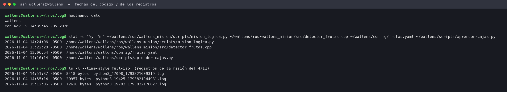
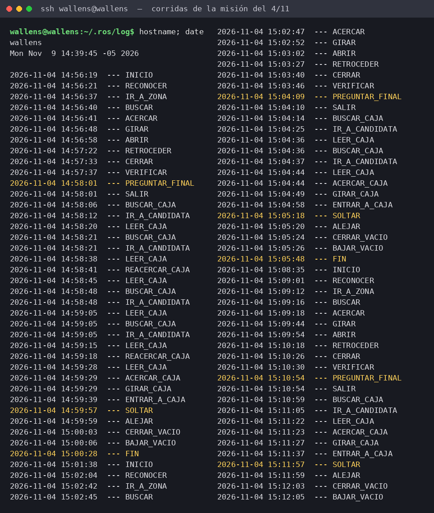

# Evidencia: código y ejecución del robot en la evaluación del 4/11/2026

Esta carpeta solo contiene documentación. **No modifica código.** El código evaluado es el de la etiqueta
[`evaluacion-4nov`](https://github.com/sebas2868/Wallens_neuro/tree/evaluacion-4nov). Todos sus archivos se modificaron por última vez el 4/11/2026
antes de las 14:25 (hora de Colombia).

## 1. El código de la Raspberry Pi es el mismo de la etiqueta `evaluacion-4nov`

El 9/11/2026 se comparó por SSH, sin modificar nada, la huella SHA-256 de cada uno de los 168 archivos del
repositorio con la copia que tiene el robot en `~/wallens`:

- **166 idénticos**, que son todo el código del robot.
- Distinto: solo `musica/reproductor.cpp`, el reproductor de música, que no es parte de la misión.
- No está en la Pi: solo `docs/plan-reconocimiento-frutas.md`, que es un documento.

El detalle está en [`huellas_codigo_en_la_pi.txt`](huellas_codigo_en_la_pi.txt), con huella, fecha de
modificación en la Pi y archivo.

## 2. Corridas de la misión el 4/11/2026

Los registros de ROS 2 del nodo `mision_frutas` guardan dentro de cada línea la hora Unix de cada estado.
El robot completó tres veces la misión hasta soltar la fruta en la caja: **14:59:57, 15:05:18 y 15:11:57**.

- [`registros_ros/`](registros_ros/): los registros originales copiados de `~/.ros/log` de la Pi, sin editar.
- [`corridas_mision_4nov.txt`](corridas_mision_4nov.txt): los mismos estados con la hora convertida.

Las imágenes son la salida de comandos ejecutados por SSH en la Pi el 9/11/2026 a las 14:39, convertida a imagen.
Los comandos y sus resultados aparecen tal cual.
